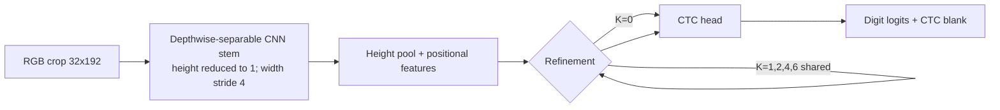

# LoopOCR-v1 Literature Landscape

Status: initial, targeted architecture grounding; not a systematic review. Checked 2026-10-19.

## Relevant primary sources

| Work | Main idea and evidence | Transfer hypothesis for OCR | Limitations for this project |
|---|---|---|---|
| Li et al., **Edge-RecViT: Efficient Vision Transformer via Semantic-Refined Dynamic Recursion**, CVPR 2026. [CVF Open Access](https://openaccess.thecvf.com/content/CVPR2026/html/Li_Edge-RecViT_Efficient_Vision_Transformer_via_Semantic-Refined_Dynamic_Recursion_CVPR_2026_paper.html) | Shared recursive Transformer layers plus an edge-aware token ranker for dynamic depth. Paper reports ImageNet-1K and transfer results; its Tiny model is 1.6M parameters and 1.72 GFLOPs, trained with a large supervised recipe. | Thin strokes and digit boundaries may benefit from retaining structurally informative horizontal locations. A later track could test boundary-aware compute allocation once a stable baseline exists. | ImageNet classification is not sequence recognition. Dynamic routing adds complexity and may prune precisely the narrow glyph strokes OCR needs. Not directly copied into v1. |
| He et al., **Vision-MoR: Scaling Vision Transformer via Patch-Level Mixture-of-Recursions**, AAAI 2026. [AAAI proceedings](https://ojs.aaai.org/index.php/AAAI/article/view/42471), [DOI](https://doi.org/10.1609/aaai.v40i6.42471) | Spatial-aware routing assigns patch-specific recursion depth with shifted-window attention. The paper reports ImageNet and COCO; the cited Small model is 5.7M parameters, well above the target. | A token-level compute policy could be useful if some digit positions are much more ambiguous than others. Measure its per-position benefit before adding a router. | Large-data vision benchmarks and higher parameter scale do not establish gains on small OCR datasets. Routing/early exit can harm alignment and thin details. |
| Bulat et al., **One Block, Multiple Depths: Recurrent Vision Transformers with Depth-Programmed Experts (reViT)**, arXiv:2610.12448 (2026). [arXiv](https://arxiv.org/abs/2610.12448) | Repeated application of one Transformer block; a small shared expert bank and depth-conditioned mixtures restore depth-specific transformations. Reported experiments include multiple seeds and ImageNet/transfer settings. | Iteration conditioning is a minimal way to distinguish refinement steps; a future expert-bank variant can test whether a single shared transition is too restrictive. | Pretraining/distillation and large supervised data dominate the paper's vision setting; no evidence is specific to character recognition. Not part of the first minimal implementation. |
| Huang et al., **Looped Transformers as Optimizers**, arXiv:2609.37379 (2026). [arXiv](https://arxiv.org/abs/2609.37379) | Frames recurrent hidden-state transitions through local optimization updates and derives OperLoop transitions. Main evidence is language/generative evaluation rather than OCR. | Motivates treating recurrent steps as learned state updates, not simply repeating depth blindly. Track intermediate CTC outputs and whether later passes correct earlier errors. | Not a vision/OCR result; direct optimization-inspired transition variants are deferred until the shared-block control is stable. |

## Design decision for v1

Begin with a shared Transformer block applied to a horizontal feature sequence from a small depthwise-separable CNN. This is the smallest intervention that tests whether iterative sequence refinement helps, while preserving a CNN-only control and an untied-depth control. The first screen intentionally omits adaptive depth, expert banks, distillation, and multiple optimization changes so the result is interpretable.

## Sources

- CVF official proceedings, CVPR 2026.
- AAAI official proceedings, DOI 10.1609/aaai.v40i6.42471.
- arXiv:2610.12448 and arXiv:2609.37379 (preprints; claims should be treated as preprint evidence unless peer-reviewed status is independently verified).
